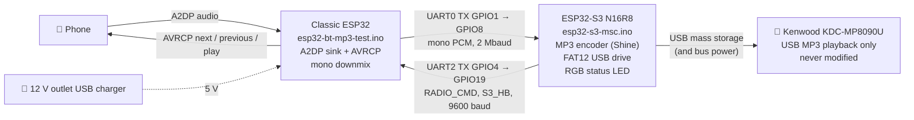
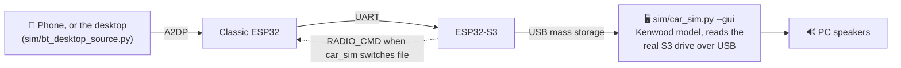

# Architecture

This covers the v2 build, the one in the car since 2026-09-25. GitHub renders the Mermaid blocks.
Flags are in [BUILD_FLAGS.md](BUILD_FLAGS.md). The radio behavior it's designed around is in
[docs/KENWOOD_RADIO.md](docs/KENWOOD_RADIO.md), and resource usage in
[docs/HARDWARE_USAGE.md](docs/HARDWARE_USAGE.md).

## Hardware

Two ESP32 boards are needed. The classic ESP32 has Bluetooth Classic (A2DP, AVRCP) but no USB
device port. The ESP32-S3 has native USB but only BLE.

A direct ground wire between the boards is required.

## Data path

1. **Phone → classic.** The classic is an A2DP sink. Its PCM callback copies each chunk into one
   of three 4 KB slots; `loop()` drains them (`DIAG_LOOP_DRAIN`: a separate task broke Bluetooth
   connectability). Chunks larger than a slot are split across slots.
2. **Classic → S3.** The classic downmixes to mono 44.1 kHz and sends it as `Q` frames
   (`common/link_protocol.h`) at 2 Mbaud, ~89 KB/s, 46% of the link. Each frame holds 5.8 ms of
   audio (512 B), a sequence number and a CRC-16. The S3 drops a frame that fails the CRC; the next
   good frame's sequence number says how many are missing, and exactly that much audio is filled
   (`common/pcm_link_rx.h`). The fill repeats the last pitch period, joined without a jump, fading
   out over 23 ms, and the next good frame cross-fades in (`common/pcm_conceal.h`). Audio with no
   clear period fades to silence in ~3 ms instead. Without this, flipped bits went straight to the
   encoder as full-scale cracks. Totals survive reboots: `[s3] link lifetime: boots= crc_bad=
   lost_frames= outages=` at boot and every minute. When the phone is silent or disconnected, the classic sends
   silence, so the stream never stops.
3. **Encoding on the S3.** The S3 runs Shine (`common/mp3_pipeline.h`) at 128 kbps mono, 18-25%
   of one core. It appends the MP3 frames to the ring. The encoder used to run on the classic,
   where its ~80 KB starved Bluetooth and AVRCP (`ENCODE_ON_S3` moved it).
4. **S3 → radio.** The S3 is a USB mass-storage device (TinyUSB `USBMSC`). Every `READ10` is
   answered by `disk_read_at()` in `esp32-s3-msc/fat_disk_shared.h`.
5. **Radio → phone.** When the radio opens a different file, the S3 works out Next or Back and
   sends `RADIO_CMD:next` / `RADIO_CMD:prev` on the return link. The classic sends the AVRCP
   command to the phone.

Delay from the phone to the speaker is ~5 s: ~0.8 s of live lag on the S3, ~3.7 s of the radio's
own read-ahead, plus Bluetooth and encoding.

## The disk

| | Value |
|---|---|
| File system | FAT12, read-only in practice (writes are accepted and dropped) |
| Cluster size | 32 KB (`FATDISK_SECTORS_PER_CLUSTER=64`; 4 KB without it) |
| Files | 3, named `Stream.mp3` (8.3 aliases `STREAM~1.MP3`..`STREAM~3.MP3`) |
| File size | 1360 clusters = 44,564,480 B, ~46 min at 128 kbps (the FAT12 cluster limit shared by 3 files) |
| Volume | 133.7 MB |
| Ring | 5,570,560 B in PSRAM (`FATDISK_RING_BYTES`), ~5.8 min of audio |

The files are much bigger than the ring. That works because the radio never gets bytes by file
offset: `FATDISK_ALWAYS_SERVE_LIVE` answers every read from a live cursor that stays ~12 KB
(`FATDISK_LIVE_TARGET_LAG`) behind the newest audio. The file offset only tells the S3 which file
the radio is in and where in the open sequence it is. Bigger files mean the radio's natural file
end (a 1.9-3.5 s pause) comes around less often, once every ~46 min.

The Kenwood reads a file's size and cluster chain only at open, so the files can't be resized or
ended early while playing. Song names were dropped: the radio shows only `F01 T-0N`, and a long
file name made it refuse files.

### Serving a file open

The radio's open sequence (from the in-car trace) is: re-read the root directory and FAT, read the
file's start, read a 2 KB probe every 512 KB and the last 2 KB, read ~40 KB of the head, then
read from 0 again with a ~58 KB read-ahead burst.

| Read | What the S3 serves |
|---|---|
| Probes and the tail | Silent frames. The live cursor doesn't move |
| Offset 0 after a natural file end | Continues the stream seamlessly |
| Offset 0 after Next / Back / mount | Starts `FATDISK_RADIO_READAHEAD` (60 KB) earlier, so the burst is real audio (the radio dropped what it had read ahead) |
| Re-reads within the same open | The same bytes as the first time |

The result is 0 underruns at Next/Back/mount, and about 1 s once per natural file end. The
heartbeat `[s3] live: underruns= opens= probes=` counts them.

### Next / Back detection

`FATDISK_MULTI_FILE` watches which file the reads fall in. A switch to the next file (with wrap)
is Next; to the previous one is Back. A natural end is not relayed. A re-open of the same file is
the radio's "Back restarts the song" and is also not relayed. `live_serve_test.cpp` in
`esp32-s3-msc/crosscheck/` tests this against a model of the Kenwood.

## Robustness

| Problem | Handling |
|---|---|
| Radio doesn't re-enumerate after an S3 reset | No host after 4 s: `tud_disconnect()`/`tud_connect()`, retried every 10 s |
| Car off / engine start | USB suspend (green LED), bus resets, re-enumerate. The radio re-opens its remembered track |
| Classic reboots | `auto_reconnect` brings the phone back without touching it |
| A second device pairs | Legacy PIN requests get `0000`, SSP confirms are accepted. The watchdog only counts a successful connection as activity, not pairing attempts |
| Heap fragmentation on the classic | The encoder moved to the S3; `FRAG:` heartbeat line tracks it |
| S3 UART overflow at 2 Mbaud | RX FIFO threshold 32 B (0 overflows since) |
| Which build is on a board | Boot line with commit + flags (S3 also every 60 s), `logs/flash_history.log` |

## Power

The boards run from **two separate supplies**: the S3 from the radio's USB port (bus power), the
classic from a 12 V outlet USB charger.

The original plan was one cable, with the classic powered from the S3's 5V pin. **Tried on real
hardware and not viable.** On the ESP32-S3-DevKitC-1, the 5V header pin sits behind a Schottky
diode (D7 in the official schematic, SCH_ESP32-S3-DevKitC-1_V1.1) that OR-gates the board's two
USB ports. Power going *out* through that pin has already dropped below 5 V. Classic → S3 works
(it doesn't cross the diode). S3 → classic gave a brownout boot every time, whatever the charger:
the limit is a fixed voltage drop, not current. Fixes exist but weren't pursued: a third 5 V
source split to both boards, or bridging D7 (losing its port isolation).

**Mounting in the car (2026-10-05).** On rough roads the audio crackled. Jiggling the classic's
micro-USB power plug reproduces it. The likely mechanism (not yet measured): a momentary contact
loss sags the classic's supply and ground, which corrupts bits on the 2 Mbaud audio wire. The
`crc_bad` counter in the S3's `[s3] enc:` heartbeat will confirm or rule this out on the bench. The
firmware now hides such errors (CRC above), but the plug is still the cause. In order of effect per effort:

| Fix | Effort | Why |
|---|---|---|
| Strain-relieve the micro-USB plug: hot glue or a zip tie so the cable can't lever it | 5 min | The plug only loses contact when the cable moves it |
| 470-1000 µF electrolytic across the classic's 5V and GND pins | 10 min, solder | Rides through contact dropouts of several ms (1000 µF at ~150 mA: ~9 ms before 3.3 V regulation is lost) |
| Feed 5 V to the classic's 5V/GND header pins (soldered) instead of the micro USB | 15 min, solder | Removes the connector. Check first that the USB-serial chip doesn't load TX0 when it's unpowered |
| Mount both boards firmly; keep the audio wire and its ground short and twisted together | 10 min | Less movement and less pickup on the 2 Mbaud wire |

Open: with the car off, USB goes to suspend but the port may stay powered. Draw in that state
isn't measured.

## Bench tooling

- **`sim/car_sim.py`** models the real Kenwood and nothing else. It does 2 KB reads, the ~58 KB
  read-ahead, the open probes, the end-of-file pause, Back restart / quick double Back, folder
  wrap, the remembered track, and the `F01 T-0N` display with elapsed / file length. `kill -USR1`
  = Next, `-USR2` = Back. Change it only to match observed radio behavior.
- **Bluetooth tests** (`sim/`): `bt_desktop_source.py` makes the desktop an A2DP source with an
  auto-accept agent. `bt_switch_test.py` switches the board between devices. `bt_audio_round_test.py`
  plays audio rounds through the laptop. `bt_pair_laptop.py` pairs the laptop.
- **Host tests** (`esp32-s3-msc/crosscheck/`): the disk logic compiled on the PC, in particular
  `live_serve_test.cpp`. Run them after touching `fat_disk_shared.h`.
- **Car captures**: `esp32-s3-msc/flash.sh --trace` plus `logs/car_capture.sh` log every SCSI
  command the radio sends. That's where `docs/KENWOOD_RADIO.md` comes from.
- **Serial logs**: `logs/serial_logger.py` (classic: `--baud 2000000 --mode framed`; S3:
  `--baud 115200 --mode line`, 921600 with the trace).

Older tools (`real_s3_listen.py`, `s3_real_firmware_host*.cpp`, `fat12_disk.py`, the
`s3_sim*.py` prototypes) came before the S3 board existed or before car_sim read the real drive.
They're kept for reference.

## History

| Build | Date | Shape |
|---|---|---|
| Stage 1 | early | Digispark/ATtiny (V-USB) proof that a fixed-size FAT12 drive served on demand works (`firmware/`) |
| v1 | 2026-09-18 | Classic encodes. One big file on the ring, radio reads by offset. First car success, ~10 s delay |
| v2 | 2026-09-25 | S3 encodes. Three files served live, Next/Back relayed. ~5 s delay |

The FAT16 fallback (`esp32-s3-msc-fat16-fallback/`) was insurance in case the radio rejected
FAT12. It didn't, and the fallback predates v2. The full history is in
[progress/STATUS.md](progress/STATUS.md).
